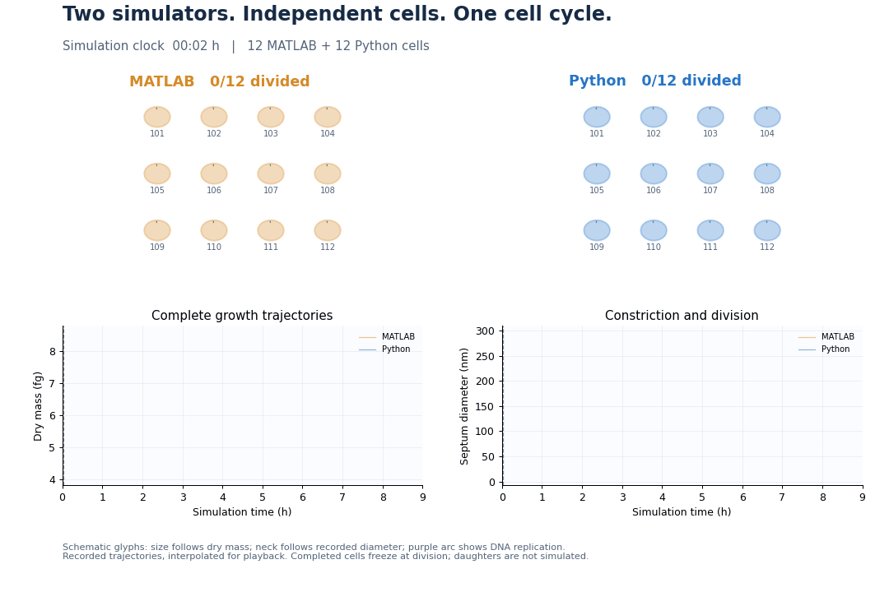
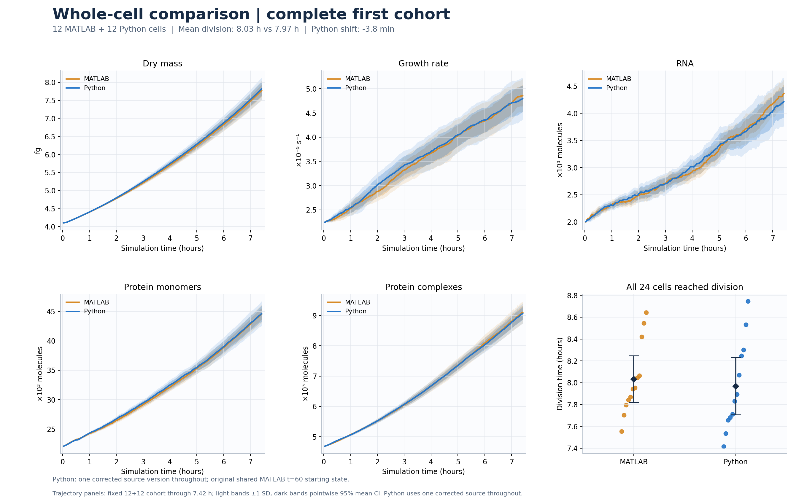
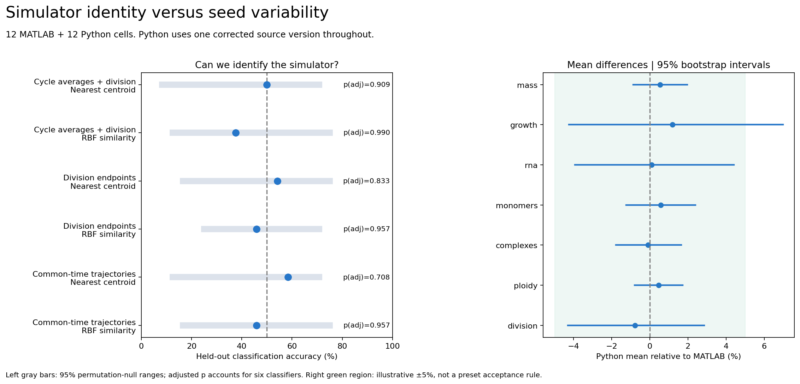
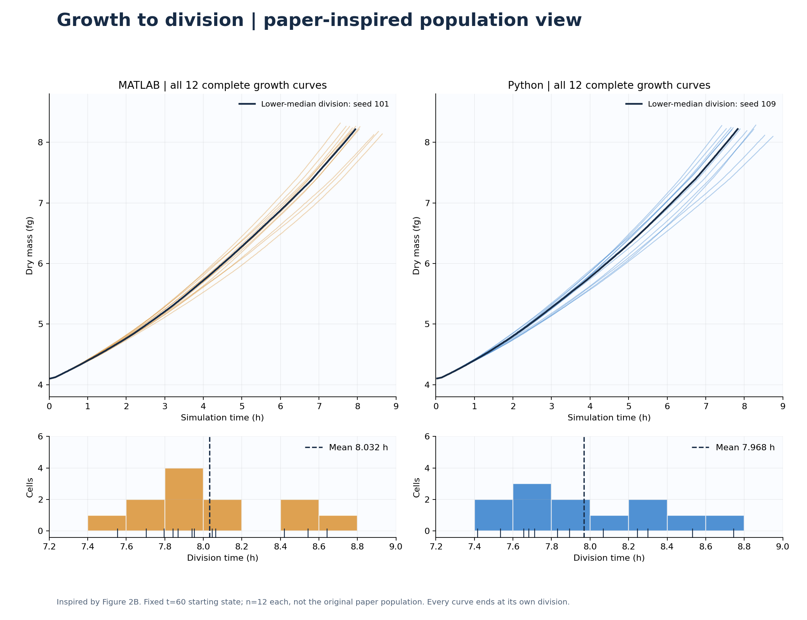
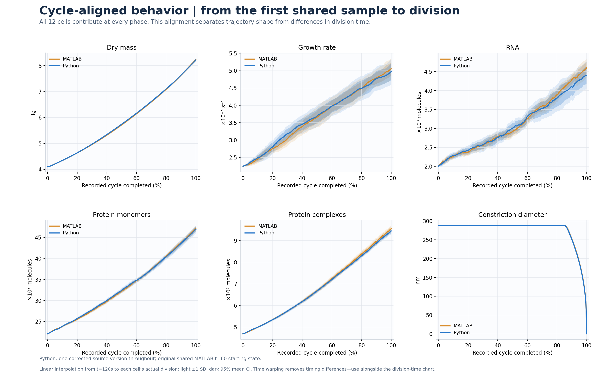
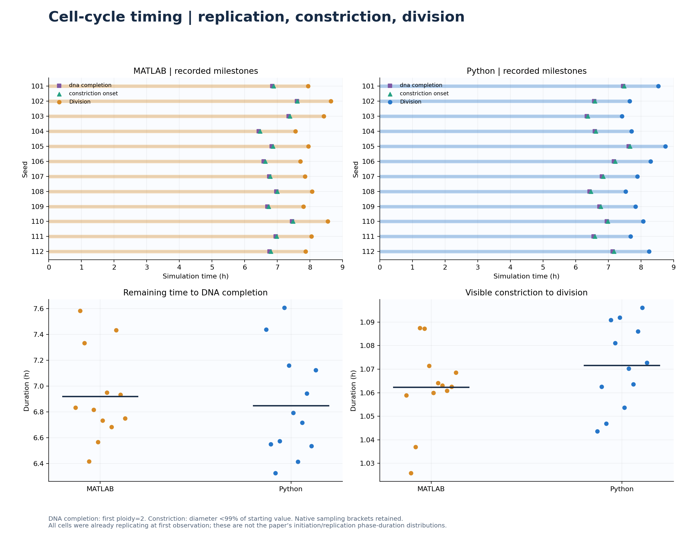
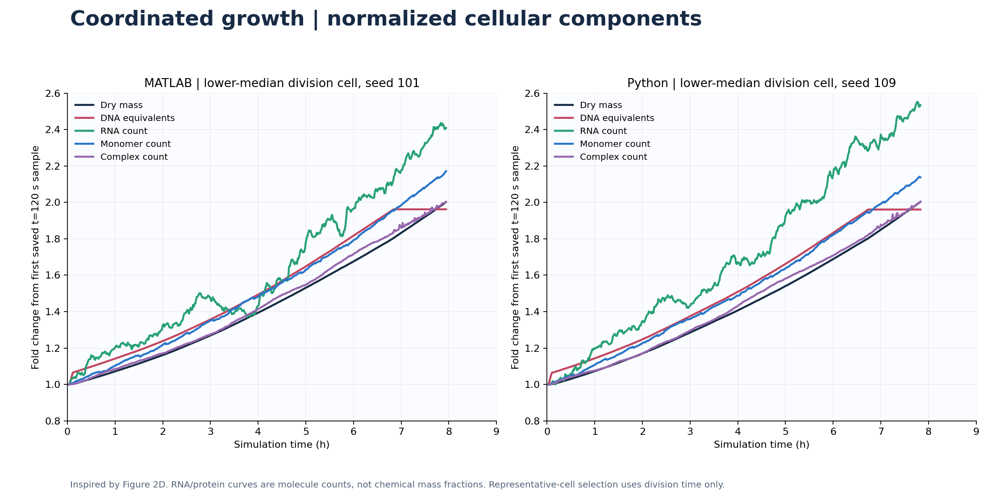

# WholeCell-python

WholeCell-python is an independent, source-faithful Python implementation of the Karr et al. (2012) *Mycoplasma genitalium* whole-cell model. It represents the original 28 processes and 16 state categories and runs without MATLAB using supplied fitted model data. Complete Python cell cycles have been compared with licensed MATLAB reference simulations. Noonautics Labs maintains the Python port; Karr and colleagues created the original biological model.



*Independent simulations from the same initial biological state. Cell geometry and DNA placement are schematic; completed cells freeze at division.* [Watch the MP4](docs/figures/whole_cell_comparison.mp4)

## Results



*Growth, cellular composition and replication across the completed ensembles.*

The fixed cohort comprises 12 MATLAB and 12 Python cells, seeds 101–112, starting from the same MATLAB biological state at t=60 seconds with independent random streams. All 24 divided. The Python cells used one corrected source version throughout, without checkpoint splices or code changes. Whole cells are the statistical replicates; matching seed labels do not pair trajectories.

Mean division time was 8.032 h in MATLAB and 7.968 h in Python: a difference of −3.80 minutes (95% whole-cell bootstrap interval −21.34 to +13.43 minutes). Across the common t=120–26,700 s window, Python relative means differed by +0.53% for dry mass, +1.19% for growth, +0.10% for RNA, +0.57% for protein monomers, −0.09% for protein complexes and +0.45% for DNA replication. Division endpoint mass differed by −0.12% (95% interval −0.65% to +0.39%).

The best of six previously selected classifier/feature combinations identified 14 of 24 cells, with multiplicity-adjusted permutation p≈0.71; the common-window averages plus division time nearest-centroid rule identified 12 of 24. These tested rules detected no reliable separation. The comparison does not establish universal indistinguishability or equivalence, and is conditional on one starting state and the measured observables. The four additional completed Python cells were excluded by the original cohort designation. [Data, provenance and results](validation/fixed-cohort/README.md) · [Validation design](docs/validation.md)



*Simulator identification and mean-difference uncertainty, treating each whole cell as an independent replicate.*

## Growth and division



*Individual growth curves and division distributions from the 12 MATLAB and 12 Python cells.*



*Cell-cycle alignment compares biological progression across cells with different division times.*

<details>
<summary>Replication milestones and cellular composition</summary>





</details>

These figures use the recorded fixed-cohort observables. The paper-inspired panels are not exact reproductions of the original paper's analyses. [Figure methods and scope](docs/paper-reproduction.md).

## Model and implementation

The [original WholeCell project](https://github.com/CovertLab/WholeCell) integrates molecular processes into a single cell model. This port traces the original classes, methods, hooks, utilities and native boundaries, using original utility source and MathWorks documentation to reproduce the needed compatibility semantics. It preserves the fitted data, algorithms, state and process responsibilities, and execution order. Deterministic compatibility tests are distinct from stochastic ensemble comparisons; independent random streams cannot provide an exact paired-trajectory oracle.

The [simulation scheduler](wholecell_py/simulation.py) coordinates [processes](wholecell_py/processes/) and [states](wholecell_py/states/), including ownership and synchronization. Compatibility components handle MATLAB indexing, dimensions and column-major order, [sparse](wholecell_py/sparsemat.py) and [circular sparse](wholecell_py/circular_sparsemat.py) arrays, [random sampling](wholecell_py/randstream.py), sequence and chromosome operations. The [solver boundary](wholecell_py/solvers.py) uses GLPK 4.44 as its principal backend. [Loading](wholecell_py/loader.py) and [checkpointing](wholecell_py/checkpoint.py) restore model state. See [MATLAB compatibility](docs/matlab-compatibility.md) and [runtime contracts](docs/runtime-contracts.md).

## Install and run

Use a source checkout on Linux or macOS with Python 3.11, a C compiler, `make` and `tar`. MATLAB is not required with the supplied fitted data; creating new MATLAB exports requires the original setup and a license. The supported installation is editable: a standalone wheel does not contain the complete fixtures and native driver.

```sh
python3.11 -m venv .venv
. .venv/bin/activate
python -m pip install -e '.[validation]'
python scripts/prepare_fixtures.py
./scripts/build_glpk.sh
python scripts/verify_installation.py
mkdir -p runs
OPENBLAS_NUM_THREADS=1 OMP_NUM_THREADS=1 MKL_NUM_THREADS=1 \
  python -m wholecell_py.runner \
  --snapshot reference/snapshot_t60.json --seed 101 \
  --steps 50000 --stop-at-division \
  --checkpoint runs/seed_101.pkl --checkpoint-every 600 \
  > runs/seed_101.jsonl 2> runs/seed_101.stderr.log
```

Use separate seeds and output files for independent cells. Inspect stdout and stderr as well as growth, mass, replication and division. Nondivision at the step limit is censored; an error is a failure. Load pickle checkpoints only from trusted sources. [Reproduction instructions](docs/reproducing.md) describe dependency versions, fixture checksums, reanalysis and provenance.

## Performance and scope

On Ubuntu, 16 completed Python cells had a median wall time of 6.01 h; 10 uninterrupted MATLAB cells had a median of 2.40 h, with a median throughput ratio of about 2.48 in MATLAB's favor. Concurrency, logging and background load differed, so this is not a controlled same-resource benchmark. [Timing records](validation/ubuntu-full-cycle-timing.json). Earlier paired 20-step Python optimization measurements were approximately 1.26–1.30×; they are neither full-cycle nor MATLAB speedup measurements.

Raw knowledge-base loading and full `fitConstants` are incomplete; fitted data are required. Fresh initialization has targeted tests and smoke coverage but no full-cycle ensemble validation. Rare compatibility paths, perturbations and internal states remain incompletely validated, and the paper's knockout studies and all figures have not been reproduced. See [limitations](docs/limitations.md) and [initialization](docs/initialization.md). Historical mixed-version evidence is [separate](validation/provisional/README.md).

## Citation and licenses

Karr JR et al. “A Whole-Cell Computational Model Predicts Phenotype from Genotype.” *Cell* 150(2), 389–401 (2012). [doi:10.1016/j.cell.2012.05.044](https://doi.org/10.1016/j.cell.2012.05.044). Cite the original model and identify the version or source digest of this port; see [CITATION.cff](CITATION.cff).

The port is distributed under [MIT](LICENSE), with the [original WholeCell notice](LICENSES/WholeCell-MIT.txt) retained. GLPK and its native driver have separate GPL terms; see [third-party notices](THIRD_PARTY_NOTICES.md).
